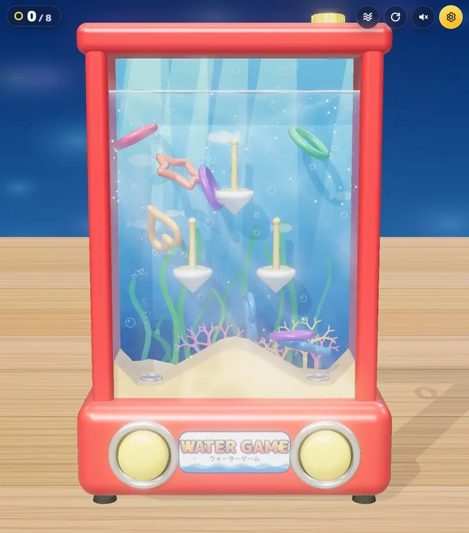
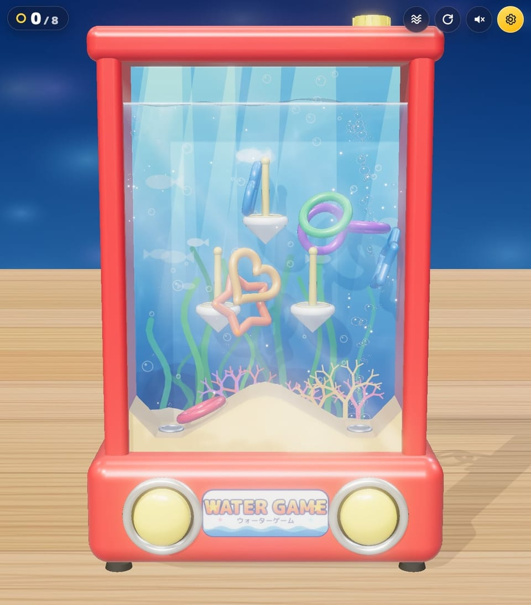
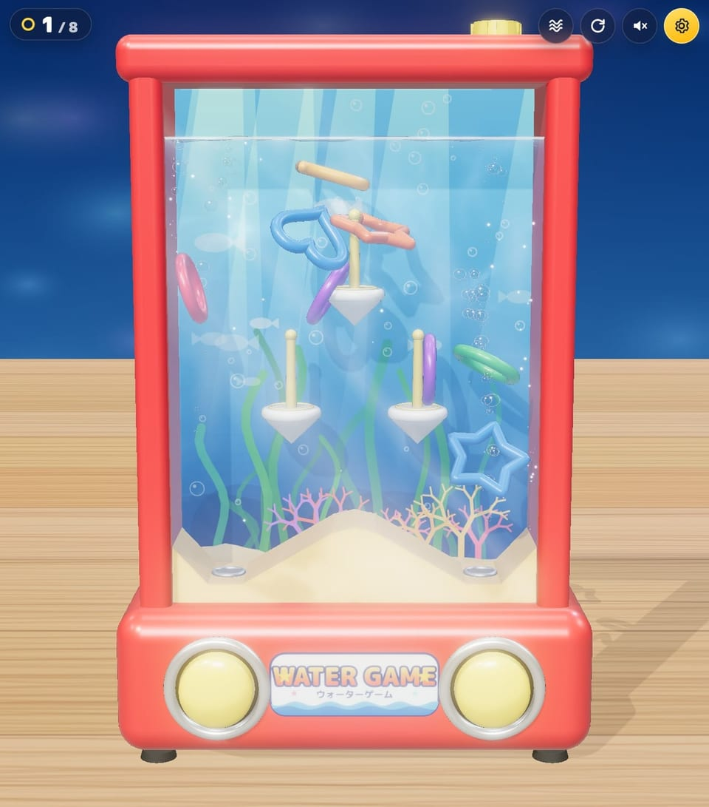
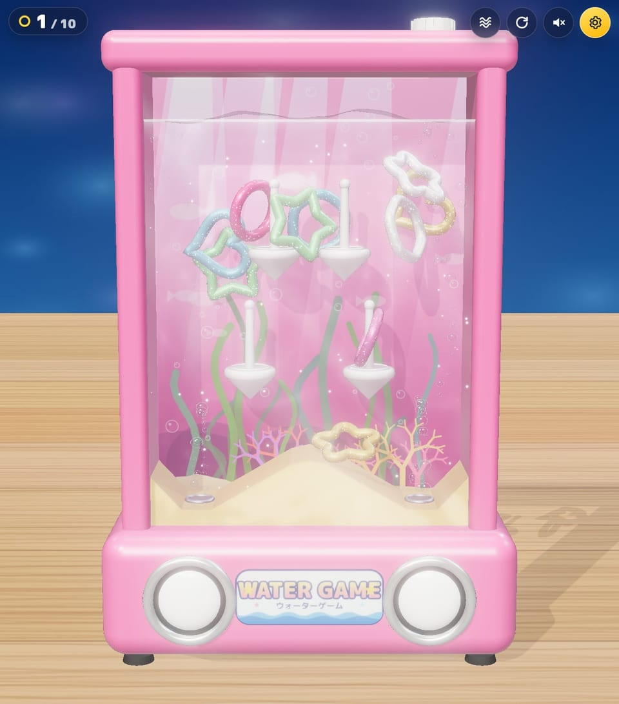
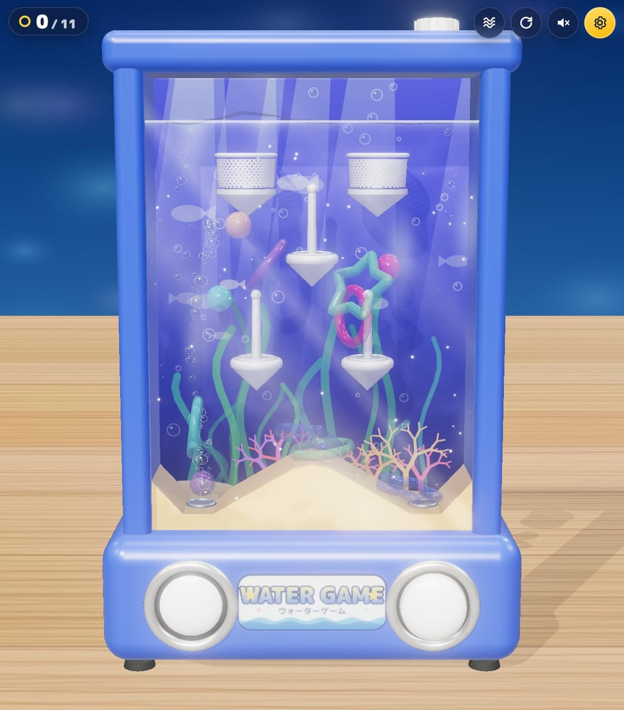
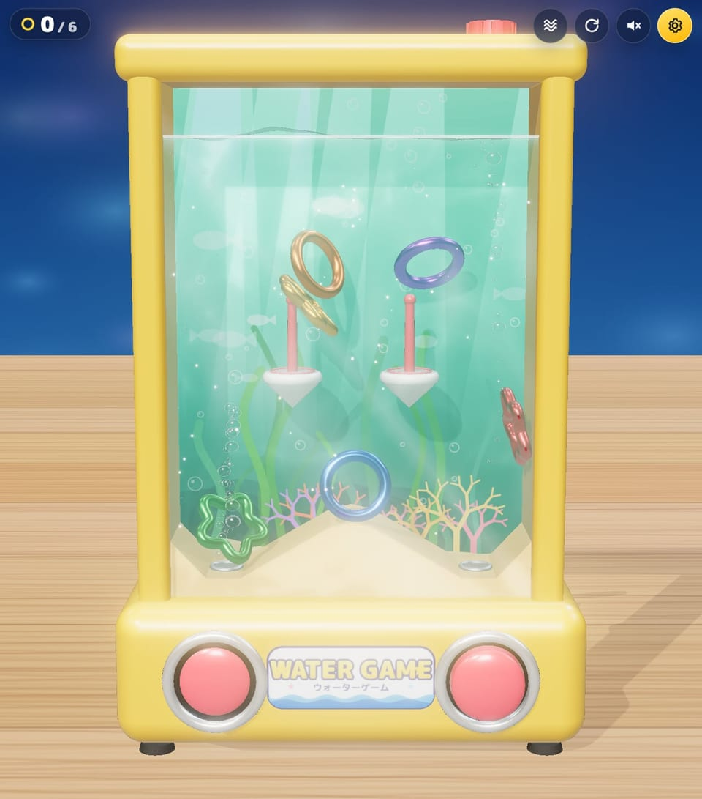
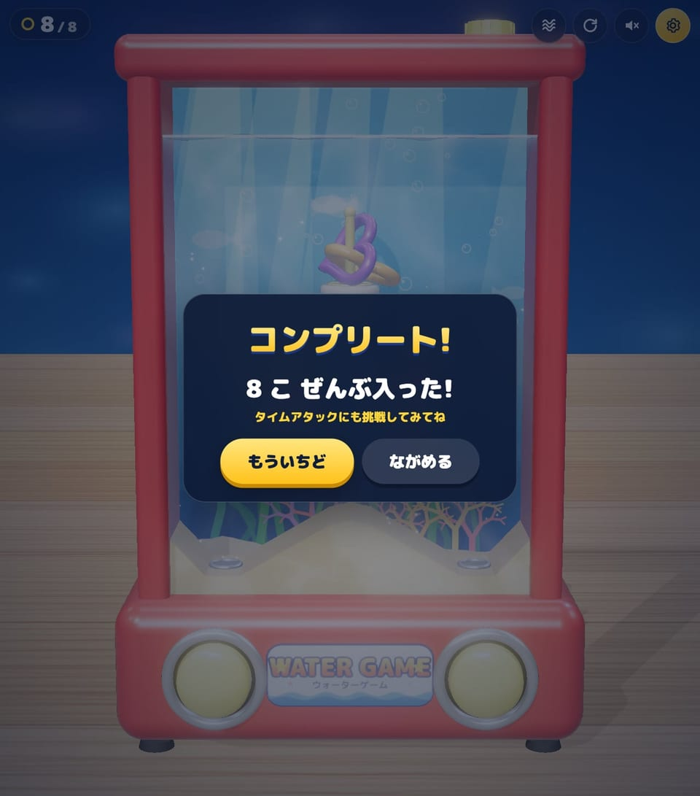
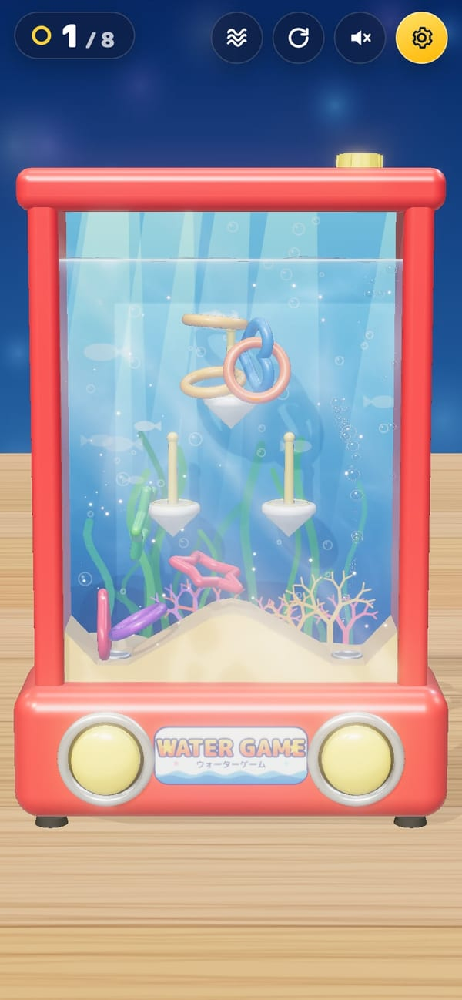
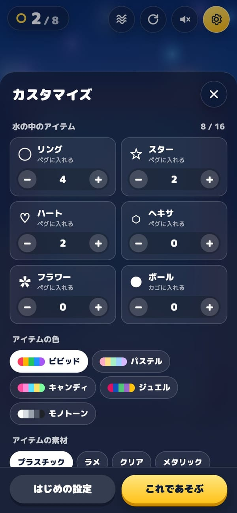

# ウォーターゲーム — Water Ring Toss 3D

ボタンで水を噴き出して、水中を舞うリングをペグに入れる。なつかしい「水中輪投げ」を、ブラウザで遊べる 3D にしました。

[](https://tanuu5.github.io/water-game/)
[](https://www.anthropic.com/claude)
[](./LICENSE)

<p align="center">
  
</p>

<p align="center"><b><a href="https://tanuu5.github.io/water-game/">▶ ブラウザで今すぐ遊ぶ</a></b>（インストール不要。PC のキーボード・マウスと、スマホのタッチ操作に対応）</p>

**Claude Code × Claude Opus 5.5（HIGH）** で作りました。

水の流れは 2D の流体シミュレーションで計算していて、ボタンを押すと渦ができ、離してもしばらく流れが残ります。リングは物理エンジンで動き、平たい形なのでひらひらと回りながら沈みます。連打するほど強く噴き出すポンプ、ケースを傾けると水平を保つ水面、泡や水中のラメ、ゆらめく光の模様など、本物のおもちゃの手ざわりを目指しました。中のアイテムの形・色・素材、水の色やとろみ、本体の色は自由に変えられます。

## スクリーンショット

<table>
  <tr>
    <td width="50%"><br><sub>ボタンを押すと、泡といっしょに水流がわき上がり、リングが舞い上がる。</sub></td>
    <td width="50%"><br><sub>スターが一番上のペグに入った。左上の数字が、入った数と全体の数。</sub></td>
  </tr>
  <tr>
    <td width="50%"><br><sub>本体ピンク・水はサクラ・素材はラメ。ペグは 4 本、5 種類の形を 2 個ずつ。</sub></td>
    <td width="50%"><br><sub>ボールを入れると、上にカゴが出てくる。素材はクリア（虹色の反射）。</sub></td>
  </tr>
  <tr>
    <td width="50%"><br><sub>本体イエロー・水はエメラルド・素材はメタリック。ペグは 2 本。</sub></td>
    <td width="50%"><br><sub>全部入るとコンプリート。タイムアタックでは記録がベストタイムとして残る。</sub></td>
  </tr>
  <tr>
    <td width="50%"><br><sub>スマホの縦画面。画面の左半分・右半分をタップして遊ぶ。</sub></td>
    <td width="50%"><br><sub>歯車ボタンからカスタマイズ。アイテムは 6 種類から合計 16 個まで。</sub></td>
  </tr>
</table>

画像と動画は、すべて実際の画面です。

## 遊び方

左右のボタンで水を噴き出し、リングやスター、ハートなどをペグに通します。ボールはカゴに入れます。押した瞬間がいちばん強く、押し続けると弱まり、離すと元に戻るので、連打がいちばん効きます。

| 操作 | PC | スマホ |
| --- | --- | --- |
| 左のボタン | `A` / `←` / `F`、または画面の左半分をクリック | 画面の左半分をタップ（長押し・連打もできる） |
| 右のボタン | `D` / `→` / `J`、または画面の右半分をクリック | 画面の右半分をタップ（2 本指で左右同時も） |
| ケースを傾ける | `Q` / `E`（押している間） | 設定で「傾きセンサー」をオンにして、端末を傾ける |
| ふる | `Space` またはボタン | ボタン、またはセンサーをオンにして端末を振る |
| リセット・消音 | `R`・`M` | 画面右上のボタン |

- **モード**：時間を気にせず遊ぶ「フリー」と、全部入れるまでの時間を競う「タイムアタック」（最初にボタンを押した瞬間から計測。ベストは設定ごとに端末に保存）。
- **カスタマイズ**（歯車ボタン）

| 項目 | 選べるもの |
| --- | --- |
| アイテム | リング・スター・ハート・ヘキサ・フラワー（ペグに入れる）、ボール（カゴに入れる）。合計 16 個まで |
| アイテムの色 | ビビッド・パステル・キャンディ・ジュエル・モノトーン |
| アイテムの素材 | プラスチック・ラメ・クリア・メタリック・パール |
| ペグの数 | 2・3・4 本 |
| 水 | 色（アクア・エメラルド・サクラ・ミッドナイト・とうめい）、とろみ（さらさら・ふつう・とろとろ）、水中のラメ |
| 本体の色 | レッド・ブルー・イエロー・グリーン・ピンク・ホワイト |
| 画質 | 高・標準・軽量（スマホは「標準」から始まる） |

## 制作について

企画・ディレクション：**たぬ**　／　開発：**Claude Code（Claude Opus 5.5・推論レベル HIGH）**

設計から実装、調整、テストまで Claude Code が進めました。描画は three.js、剛体の当たり判定は Rapier、水流は自作の 2D 流体シミュレーション（Stable Fluids）で、ケースの絵・木目・ラベル・効果音はすべてコードで生成しています（画像・音声ファイルは使っていません）。調整は実 GPU のヘッドレス Chrome で行い、ランダムに連打する自動プレイでペグに入る頻度や抜けやすさを測りながら、水流の強さや台座の形を決めました。

## 更新履歴

- **2026-09-29**：公開

## 開発

ビルドは不要です。ES Modules を使うので、`file://` ではなくローカルサーバーで開いてください。three.js と Rapier は CDN（jsDelivr）から読み込むため、初回の起動には通信が必要です。

```bash
python3 -m http.server 8765
# → http://localhost:8765/
```

| ファイル | 役割 |
| --- | --- |
| `index.html` / `style.css` | 画面の骨組み、HUD・タイトル・カスタマイズ画面 |
| `js/main.js` | 全体の組み立て、入力、ポンプ、ゲームの進行、描画ループ |
| `js/fluid.js` | 2D の水流シミュレーション（ジェット、渦の強調、圧力の投影） |
| `js/physics.js` | Rapier の剛体、水の抗力・浮力、ペグ・カゴへの入り判定 |
| `js/shapes.js` | アイテムの形（輪郭の曲線、当たり判定のカプセル列） |
| `js/toy.js` | 本体・水面・水の色・ボタン・ペグの見た目 |
| `js/materials.js` | 水中の光の模様（コースティクス）とラメのシェーダー |
| `js/effects.js` | 泡・水中のラメ・得点時のきらめき |
| `js/textures.js` / `js/audio.js` | キャンバスで描くテクスチャ、WebAudio で合成する効果音 |
| `js/config.js` | 定数・プリセット・設定の保存 |

## GitHub Pages で公開する

静的なファイルだけなので、リポジトリの Settings → Pages で「Deploy from a branch」→ `main` / `/ (root)` を選べば、そのまま公開されます。

## クレジット・ライセンス

- コード：MIT License（[LICENSE](LICENSE)）© 2026 たぬ
- 3D 描画：[three.js](https://threejs.org/)（MIT License、CDN から読み込み）
- 物理エンジン：[Rapier](https://rapier.rs/)（`@dimforge/rapier3d-compat`、Apache License 2.0、CDN から読み込み）
- フォント：[M PLUS Rounded 1c](https://fonts.google.com/specimen/M+PLUS+Rounded+1c)（Google Fonts、SIL Open Font License、ページから読み込み）
- 水中輪投げという昔ながらのおもちゃを題材にしたオリジナル作品です。特定の商品やメーカーとは関係ありません。
- MIT License の対象はこのリポジトリのコードと文章です。「Claude」の名前や商標の使用を許諾するものではありません。
